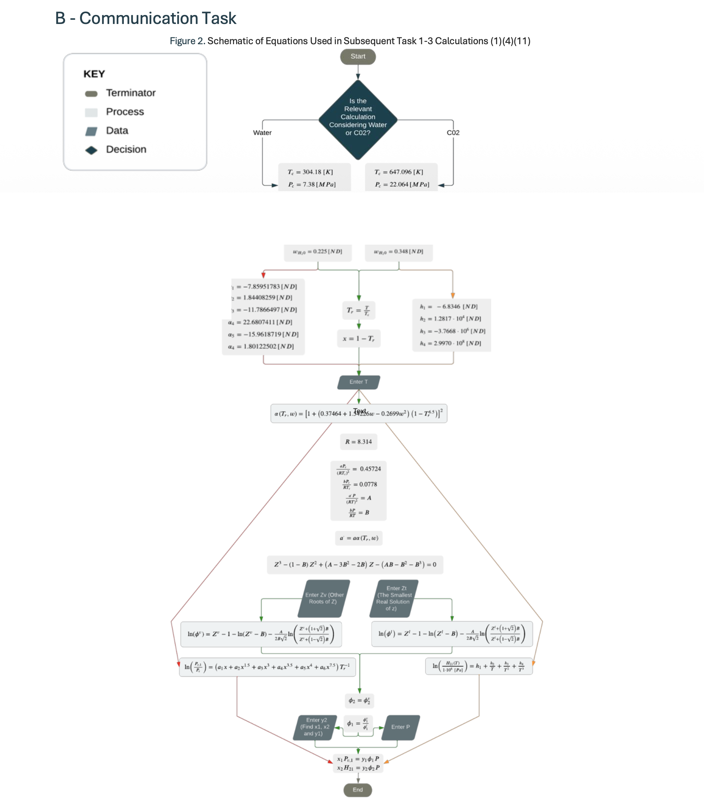
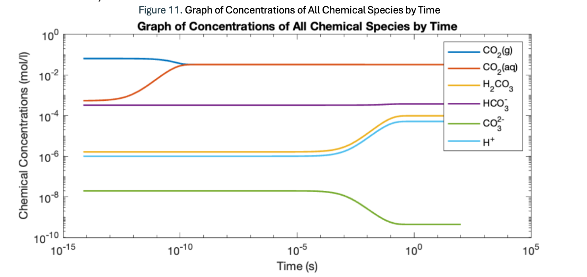
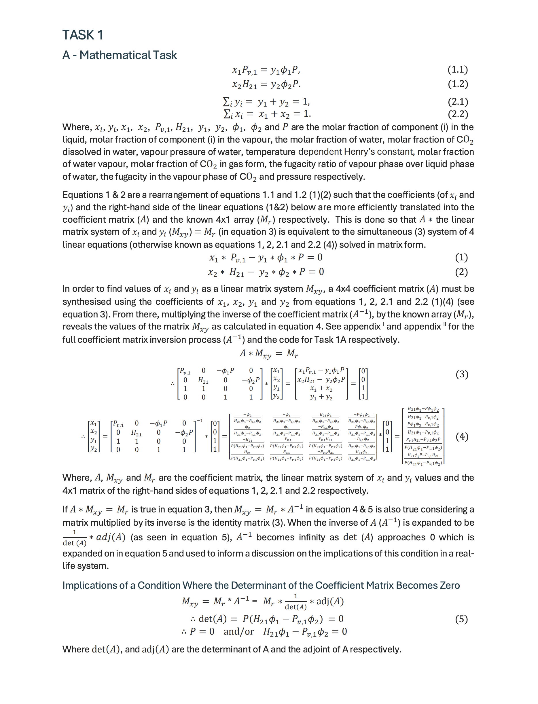
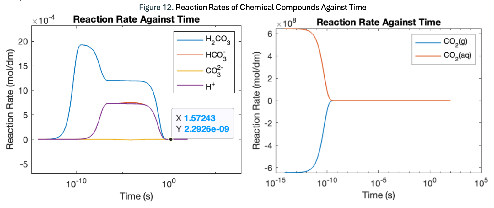

# MATLAB Research - CO2 Dissolution in Water

Mathematical model of the solubility of carbon dioxide in seawater using Henry's Law, Henry's Constant, Reaction Kinetics, and the Peng-Robinson Equation to model the equilibrium concentration of CO2 in water over time.

Also, to solve the system of ordinary differential equations for all chemical species that dissolve into the sea. Dataset included.

